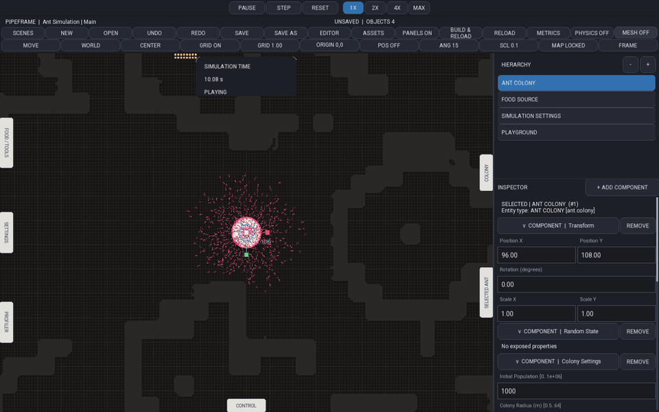
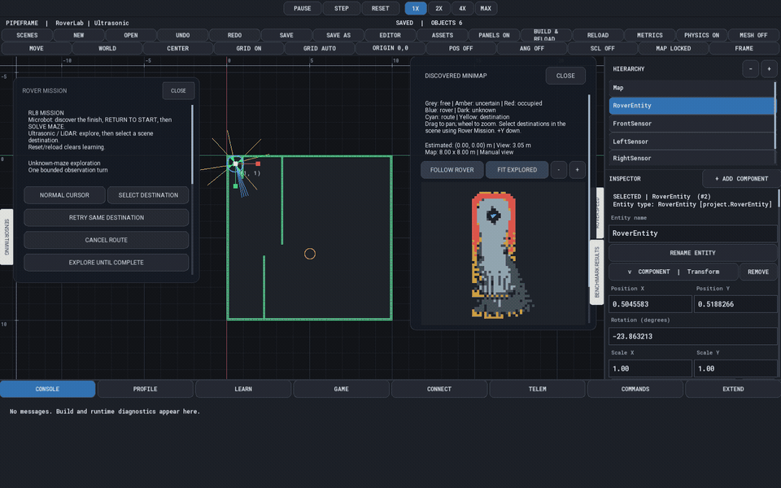
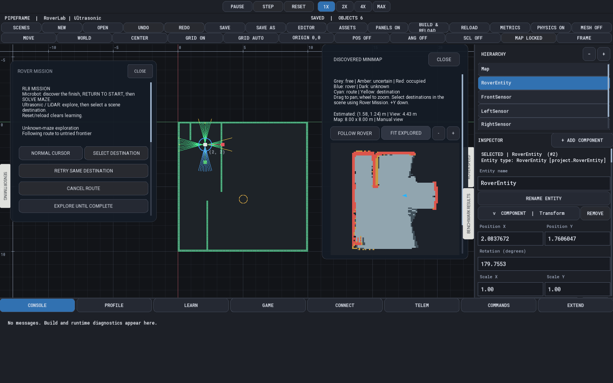
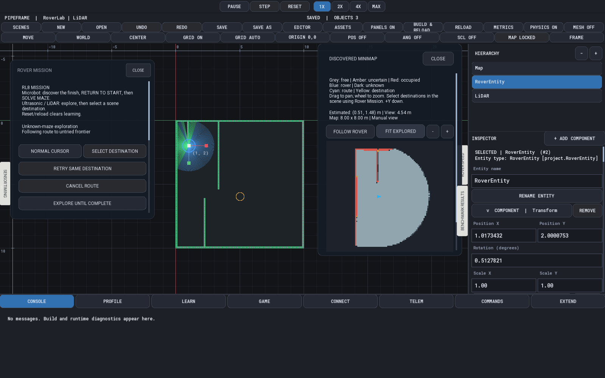
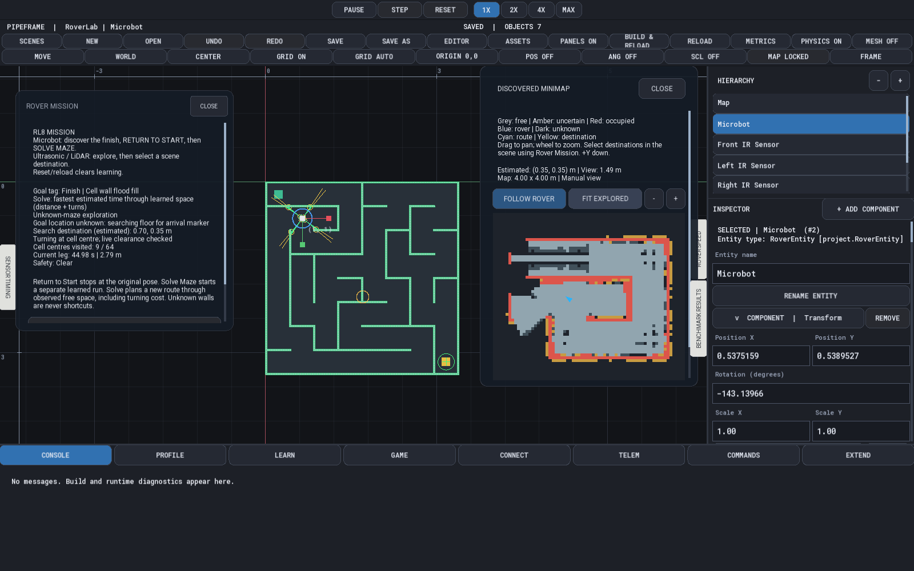
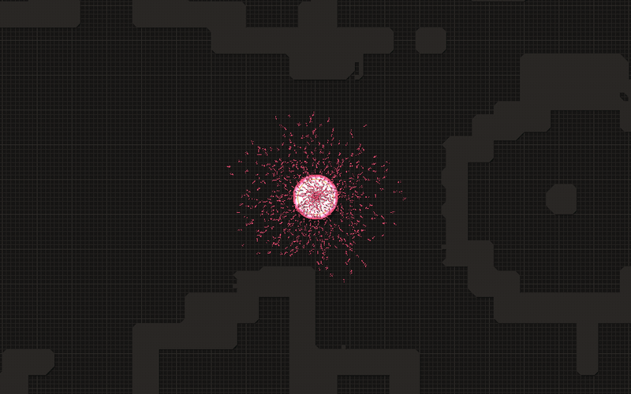
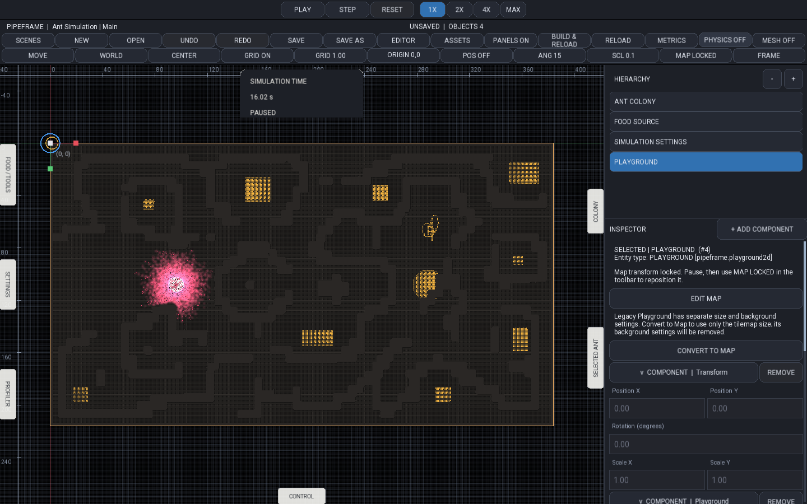
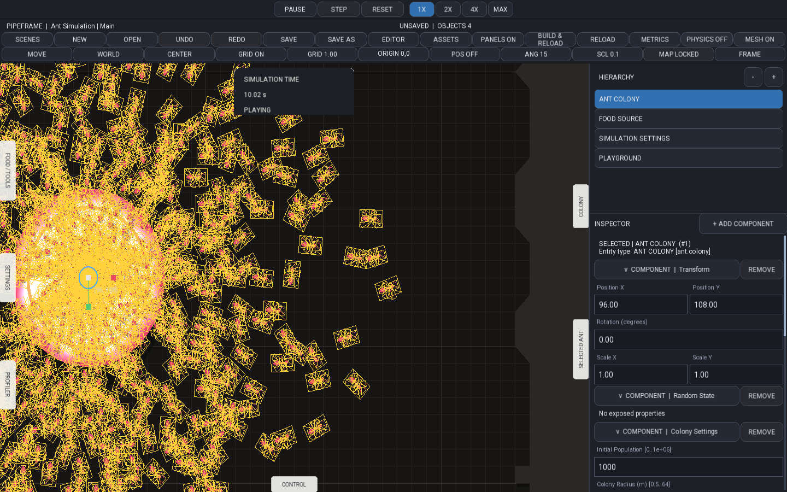

# PipeFrame

PipeFrame is a modular **C++20** simulation engine and desktop editor (**Simulation Workbench**) for deterministic 2D multi-agent and robotics simulations. It provides entity/component scenes (`ECS`), schema-driven Inspector controls, 60 Hz fixed-step simulation phases, spatial collision helpers, tilemap authoring, project UI drawers, deterministic replay capture/playback, and live **Build & Reload** for project runtime plugins. SFML supplies the native rendering and windowing backend.



---

## Included Simulations

| Project | Overview & Key Capabilities |
| --- | --- |
| **[RoverLab](examples/RoverLab/README.md)** | Autonomous 2D robotics perception, mapping, and motion planning simulation featuring rotating **LiDAR**, **ultrasonic sonar**, **infrared** wall sensors, wheel **odometry** with pose interpolation, log-odds **occupancy grid mapping**, configuration-space obstacle inflation, swept-footprint safety validation, utility-based **frontier exploration**, turn-cost **A\*** / **Dijkstra** / **BFS** / **DFS** / **Flood-Fill** / **Right-Hand** planners, Micromouse maze solving, headless **JSONL/CSV benchmarking**, and **CTest** regression suites. |
| **[AntSimulation](examples/AntSimulation/README.md)** | Interactive multi-agent colony foraging simulation modeling emergent **pheromone trails**, food collection, spatial circle/wall collision resolution, zoom-dependent batched geometry rendering (`LOD`), live environment food/terrain brushes, and per-agent telemetry inspection. |

### RoverLab — Autonomous Mapping, Frontier Exploration & Motion Planning



RoverLab ships five scenes (**Ultrasonic**, **LiDAR**, **Microbot**, **MicrobotMedium**, and **MicrobotHard**):
- **Room Exploration & Goal Navigation (`Ultrasonic`, `LiDAR`):** The rover explores unknown multi-room geometry using delayed/noisy sensor observations, builds an expanding log-odds occupancy grid in real time (`DISCOVERED MINIMAP`), and routes to user-selected scene destinations using time-cost **A\*** with swept turning-clearance checks.
- **Micromouse Maze Solving (`Microbot`, `MicrobotMedium`, `MicrobotHard`):** A compact maze robot equipped with four short-range infrared wall sensors classifies cell boundaries, discovers the unknown goal marker via flood-fill, returns to the start pose, and executes a separate fastest-time **A\*** solve over the learned cell graph.

| Ultrasonic Sonar Exploration | 360° Rotating LiDAR Exploration | Microbot Micromouse Maze |
| --- | --- | --- |
|  |  |  |

> **Scope note:** These projects use deterministic geometric sensing and motion models designed for studying autonomous navigation, mapping, and simulation architecture—not hardware-calibrated robot controllers or full loop-closure SLAM.

---

### AntSimulation — Multi-Agent Colony Foraging & Pheromone Fields



| Authored Playground & Tilemap | Batched Mesh & Debug Geometry |
| --- | --- |
|  |  |

---

## Build

Development and testing target macOS. Install a **C++20** compiler, **CMake 3.25+**, **Ninja**, and [vcpkg](https://github.com/microsoft/vcpkg). Set `VCPKG_ROOT` to your vcpkg checkout (`vcpkg.json` declares `sfml` and `nativefiledialog-extended`).

From the repository root:

```sh
cmake --preset release \
  -DCMAKE_TOOLCHAIN_FILE="$VCPKG_ROOT/scripts/buildsystems/vcpkg.cmake" \
  -DPIPEFRAME_ANT_REWORK_ONLY=ON
cmake --build --preset release --target SimulationWorkbench RoverLabRuntime AntSimulationRuntime
```

The `PIPEFRAME_ANT_REWORK_ONLY` option excludes the older SailBoat prototype while building the Workbench, **AntSimulation**, and **RoverLab** targets. On macOS, CMake configures dynamic vcpkg libraries so the editor and hot-reloaded runtime plugins share the native backend cleanly.

---

## Run a Project

Open **RoverLab** in the Simulation Workbench:

```sh
./cmake-build-release/apps/SimulationWorkbench/SimulationWorkbench \
  --project examples/RoverLab/project.pipeframe
```

Open **AntSimulation** in the Simulation Workbench:

```sh
./cmake-build-release/apps/SimulationWorkbench/SimulationWorkbench \
  --project examples/AntSimulation/project.pipeframe
```

You can also launch `SimulationWorkbench` without arguments and click **Open** to select any `project.pipeframe` file:
- Use **Build & Reload** after modifying project C++ code, select a scene from **SCENES**, and press **Play**.
- **Pause**, **Step**, **Reset**, and speed multipliers (**1X / 2X / 4X / MAX**) control fixed-step execution; **Reset** restores the authored starting scene state.
- Toggle **PHYSICS** or **MESH** in the viewport toolbar to inspect sensor rays, collision bodies, swept safety envelopes, and triangle geometry.
- In **RoverLab**, open **ROVER MISSION** for autonomous exploration and destination routing, **DISCOVERED MAP** for pan/zoom/follow occupancy inspection, and **BENCHMARK RESULTS** to compare batch runs and export filtered CSVs.
- In **AntSimulation**, open **FOOD / TOOLS** for live food painting and **SELECTED ANT** to follow and inspect individual ants.

### Headless RoverLab Benchmark Runner

Run repeatable offline batch experiments across scenes, planners, seeds, and sensor noise profiles without opening an editor window:

```sh
cmake --build --preset release --target RoverLabBenchmark RoverLabRuntime
./cmake-build-release/examples/RoverLab/RoverLabBenchmark \
  --plan examples/RoverLab/Benchmarks/baseline.pfbench \
  --output /tmp/roverlab-baseline-01
```

---

## Source Layout

```text
engine/                         Shared C++20 ECS engine, UI framework, and SFML backend
apps/SimulationWorkbench/       Desktop editor, viewport tools, inspector, and runtime host
examples/RoverLab/              Autonomous rover mapping, planning, benchmark runner, and tests
examples/AntSimulation/         Multi-agent ant colony simulation, custom brushes, and tests
benchmarks/AntBenchmark/        Headless ant simulation benchmark executable
docs/                           Architecture plans, UI docs, and portfolio media
```

Within each simulation project:

```text
Source/
  Components/          ECS data structures and Inspector schemas (Component<T>)
  Entities/            Entity composition and prefabs
  Editor/              Project dashboard drawers (ViewPanel), brushes, and tools
  World/
    Simulation/        Fixed-step simulation state, sensors, mapping, and planners
    Physics/           Kinematics, odometry, and collision handling
    Rendering/         Batched geometry, resources, and debug overlays
  Integration/         Plugin entry points, type registration, and runtime lifecycle
```

---

## Automated Regression Suite

Build and run the **CTest** verification suites from the repository root:

```sh
cmake --build --preset release --target \
  WorkbenchUITests AntDashboardTests RoverRuntimeTests RoverMapPanelTests \
  RoverSolverTests RoverSolverSceneTests RoverMissionTests RoverResultsTests
ctest --test-dir cmake-build-release --output-on-failure
```

The test suite (105+ CTest targets across the repository) validates ECS lifecycle, `.pfscene` serialization, deterministic replay, responsive UI layout, AntSimulation foraging/rendering, and RoverLab sensor models, occupancy mapping, motion planners, safety envelopes, Micromouse solving, and CSV benchmark reporting.
