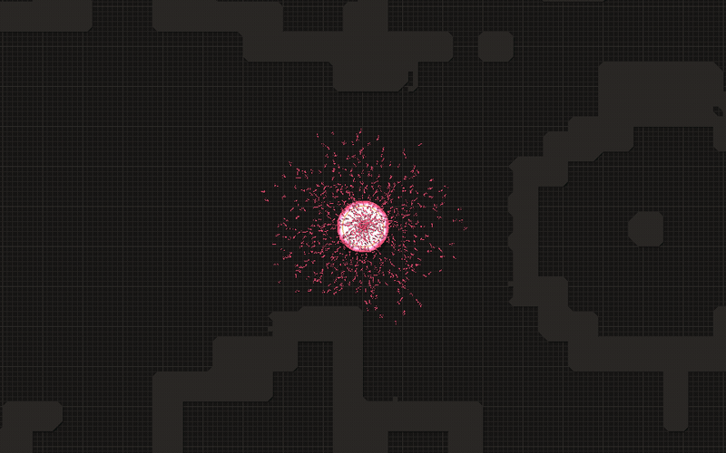
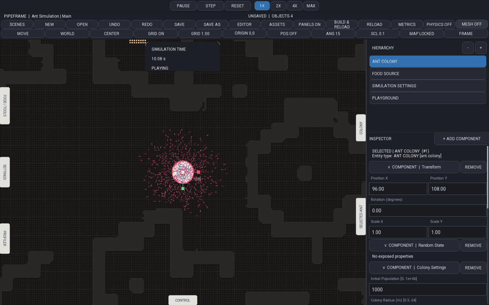
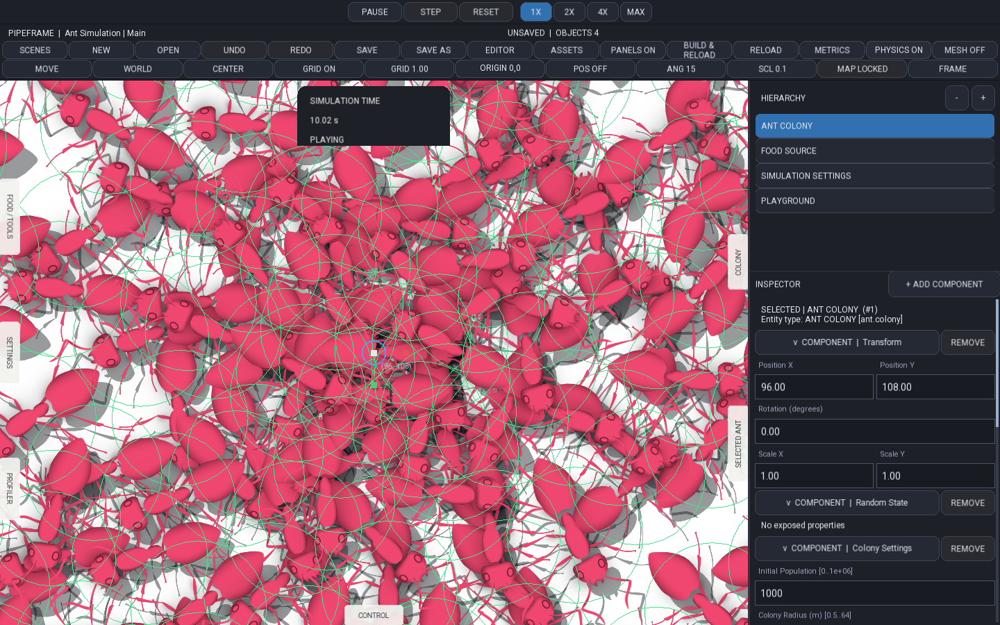
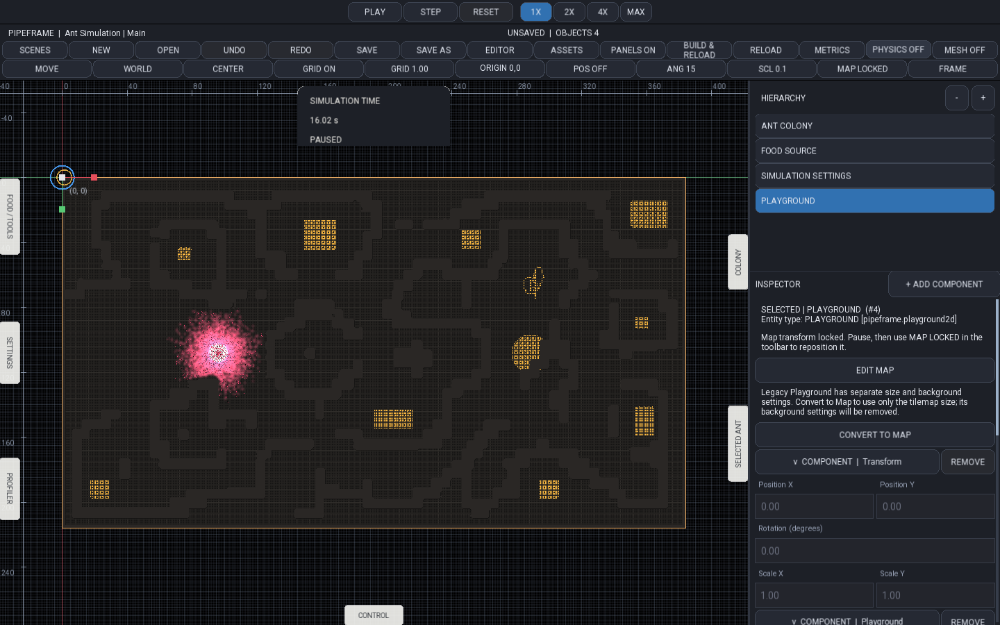
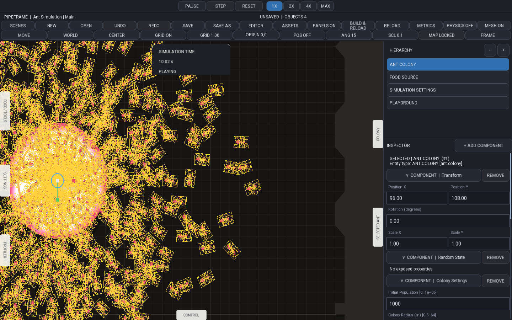

# AntSimulation

**An interactive, high-throughput multi-agent ant colony simulation built on [PipeFrame](../../README.md).**



*Captured from a Release build running at 60 Hz fixed-step updates. Emergent pheromone trails and foraging routes are simulated in real time across 1,000+ autonomous agents.*

---

## Overview

Ants leave the central colony, explore an authored 2D tilemap environment, sample chemical pheromone gradients, harvest food resources, and return deliveries to the nest. Built as a flagship multi-agent simulation on **PipeFrame**, the project combines **Entity-Component-System (`ECS`)** architecture, cache-friendly flat-array spatial queries, zoom-dependent batched geometry rendering (`LOD`), and live interactive editor tools.



---

## Key Features & Interactive Workflows

- **Emergent Multi-Agent Foraging:** Each ant maintains independent position, velocity, energy, target heading, and cargo state while interacting through shared **home** and **food** chemical pheromone fields that diffuse and evaporate every fixed step.
- **Live Environment Painting (`FOOD / TOOLS`):** Paint new food clusters directly into the running simulation with right-drag or author persistent walls and starting food distributions on `.pftilemap` assets; **Reset** cleanly restores the authored starting state.
- **Per-Agent Telemetry Inspection (`SELECTED ANT` & `COLONY`):** Click any ant in the viewport to follow it with the camera and inspect its live state, speed, remaining energy, target vector, and delivery counters.
- **Physics & Geometry Debug Overlays:** Toggle **PHYSICS ON** to visualize circle collision bodies and spatial wall boundaries, or **MESH ON** to inspect the batched triangle meshes behind every rendered ant.

| Physics Bodies & Wall Boundaries (`PHYSICS ON`) | Authored Playground Tilemap in Editor | Batched Textured Mesh Geometry (`MESH ON`) |
| --- | --- | --- |
|  |  |  |

---

## Architecture & Performance Engineering

```text
examples/AntSimulation/
├── Assets/                  Ant body/leg textures and authored Main.pftilemap
├── Config/                  Simulation and colony configuration presets
├── Scenes/                  Authored Main.pfscene
├── Source/
│   ├── Components/          ColonySettings, ColonyState, FoodSource, Foraging, SignalBeacon, SimulationSettings
│   ├── Editor/              AntPanels (Colony, Selected Ant, Food/Tools, Settings, Profiler) and food density brush
│   ├── Entities/            Colony, FoodSource, SignalBeacon, and Playground recipes
│   ├── Integration/         AntProject, AntSimulationRuntime, and AntUIHost plugin adapters
│   └── World/
│       ├── AntWorld.h/.cpp  World ownership and ordered fixed-step phase orchestration
│       ├── Physics/         Spatial grid partitioning, circle-wall sweeps, and contact resolution
│       ├── Rendering/       Zoom-dependent LOD vertex batching, shadows, and pheromone field textures
│       └── Simulation/      Colony spawning, pheromone diffusion/evaporation, and foraging steering
└── Tests/                   Unit, dashboard UI, component editing, determinism, and rendering regression suites
```

### Systems & Optimization Highlights

1. **Data-Oriented Spatial Partitioning & Reused Workspaces:**
   - High-frequency neighbor and obstacle collision queries use preallocated, contiguous flat-array spatial cells (`Physics/`) rather than per-frame heap allocations, sustaining **60 FPS** with thousands of active agents across multiple colonies.
2. **Zoom-Dependent Batched Rendering (`LOD`):**
   - The renderer dynamically switches between articulated textured body/leg triangle meshes at close zoom, simplified textured quads at medium zoom, and single-vertex point primitives at far zoom, submitting geometry in consolidated draw batches.
3. **Deterministic Fixed-Step Execution:**
   - Simulation phases (`Colony`, `Movement`, `Behaviour`, `Pheromone`, `Cleanup`) run at a fixed $\Delta t = 1/60\text{ s}$ with seeded RNGs, verified by binary replay and hash-repeatability tests.

---

## Run in Simulation Workbench

Build from the [PipeFrame repository root](../../README.md#build), then launch:

```sh
./cmake-build-release/apps/SimulationWorkbench/SimulationWorkbench \
  --project examples/AntSimulation/project.pipeframe
```

1. Press **Play** (and optionally select **2X**, **4X**, or **MAX** in the transport bar).
2. Select **ANT COLONY** in the **Hierarchy** dock to tune `Initial Population`, `Colony Radius`, or `Random Seed` in the **Inspector**.
3. Open the **FOOD / TOOLS** drawer on the left edge, choose **Add Food**, and right-drag in the viewport to drop food into active ant traffic.
4. Open the **SELECTED ANT** drawer on the right edge to lock the camera onto an individual forager.

---

## Automated Regression & Benchmark Suites

Build and run the AntSimulation test suites and headless benchmark from the repository root:

```sh
cmake --build --preset release --target \
  AntDashboardTests AntComponentEditingTests AntSimulationRuntime AntBenchmark
ctest --test-dir cmake-build-release -R '^(Ant|WorkbenchUI)' --output-on-failure
```

---

## Credits

The visual style and core biological foraging rules are adapted from **Pezzza's Work** (`AntSimulator`). This project re-architects the simulation onto PipeFrame's C++20 ECS runtime, adding schema-driven Inspector reflection, editable `.pftilemap` environment authoring, custom editor brushes, zoom-dependent LOD batching, and automated regression testing.
