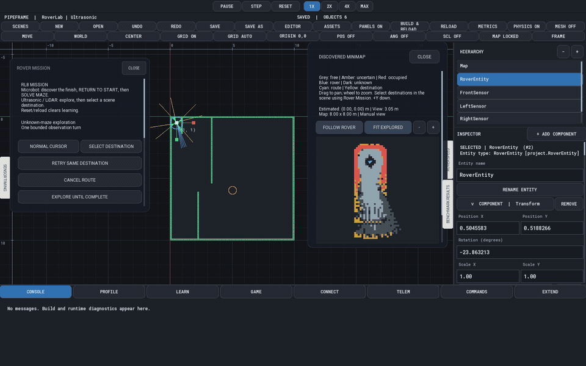
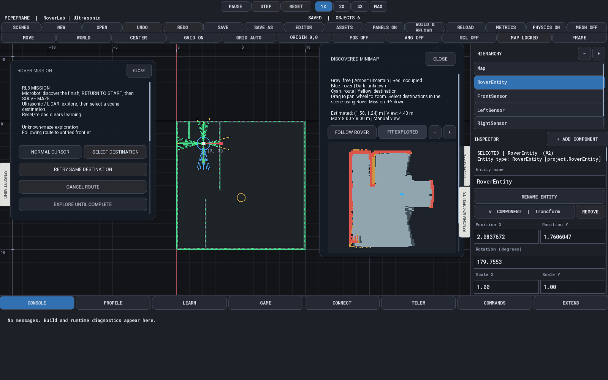
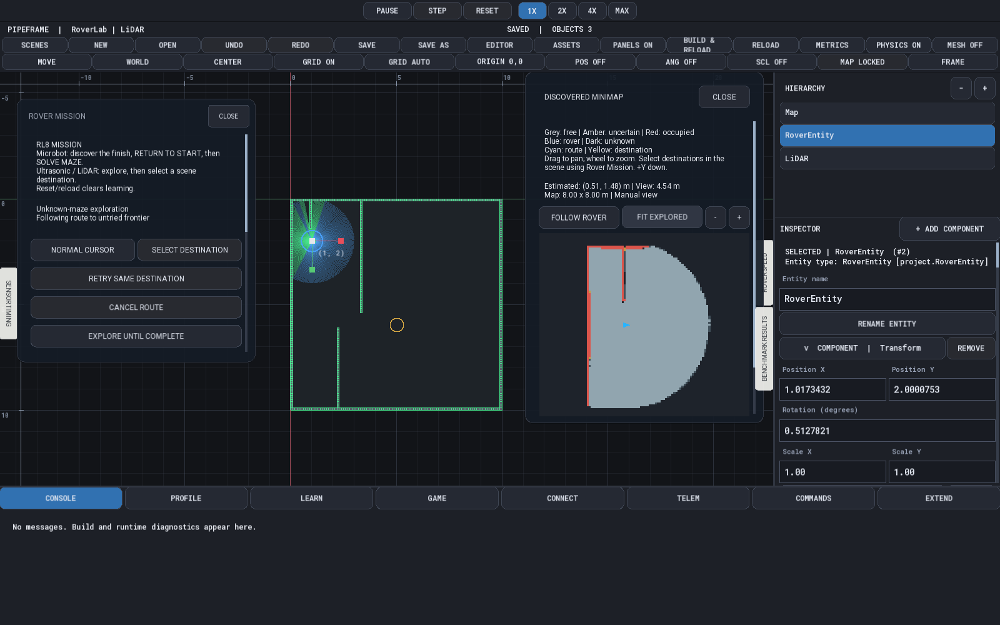
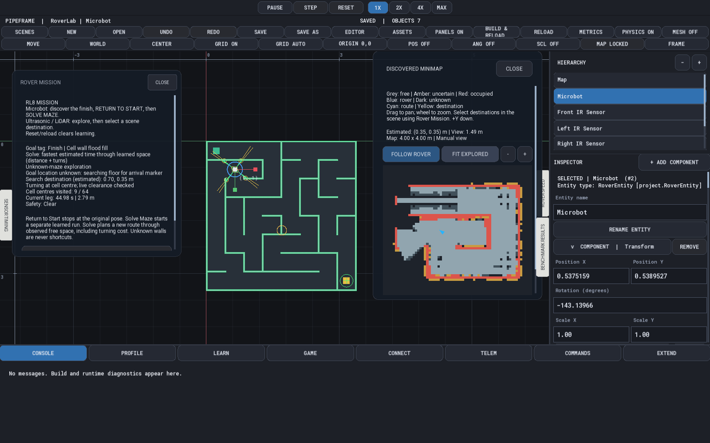

# RoverLab

**An autonomous 2D robotics perception, occupancy grid mapping, and motion planning simulation built on [PipeFrame](../../README.md).**



*Captured from a Release build running at 60 Hz fixed-step updates. First half: Ultrasonic sonar cone exploration; second half: 360° rotating LiDAR exploration with live occupancy grid mapping.*

---

## What RoverLab Demonstrates

RoverLab models an autonomous mobile robot exploring unknown 2D multi-room environments and Micromouse mazes using simulated onboard sensors, wheel odometry, expanding log-odds occupancy grids, and configuration-space motion planners. Every perception, mapping, planning, and control stage operates exclusively on the robot's estimated odometry and observed sensor returns—never querying hidden ground-truth walls.

### 1. Multi-Sensor Perception & Asynchronous Odometry Fusion

- **360° Rotating 2D LiDAR (`LidarSensorSystem`):** Samples successive laser beams across a full revolution (default 360 beams at 10 Hz, 2.0 m range), modeling configurable delivery latency, bounded uniform range noise, and seeded beam dropout.
- **Scheduled Ultrasonic Sonar (`UltrasonicSensorSystem`):** Models four directional sonar cones (`Front`, `Left`, `Right`, `Rear`) with scheduled firing windows, angular cone footprints, and noisy/delayed echo returns.
- **Infrared Wall Sensors (`InfraredSensorSystem`):** Four short-range directional sensors (`Front`, `Left`, `Right`, `Rear`) used by the Microbot to classify maze cell walls during traversal.
- **Wheel Odometry & Historical Pose Interpolation (`RoverOdometrySystem`, `RoverMappingSystem`):** Reconstructs delayed sensor scans at their capture-time odometry pose so rover movement between capture and delivery does not smear obstacle evidence.

### 2. Expanding Occupancy Grid Mapping & Configuration-Space Inflation

- **Dynamic Log-Odds Occupancy Grid (`RoverMappingSystem`):** Integrates ray/cone free-space and hit-point occupied evidence into an automatically expanding 2D grid. Dropped beams or stale readings never assert false clearance.
- **Swept-Footprint Obstacle Inflation (`MazeExploration`):** Inflates occupied and uncertain cells using precomputed robot body kernels and rotational clearance envelopes (`KnownTurnClear`) so planned paths and turns respect physical chassis dimensions.
- **$O(1)$ Integral-Image Frontier Evaluation:** Uses a 2D integral image (`unknownSum`) over unknown cells and contiguous flat-array spatial indexing (`covered`, `visits`) to evaluate candidate observation areas in $O(1)$ time per cell, achieving a **3.6x end-to-end simulation speedup** as discovered maps scale.

### 3. Motion Planning, Frontier Exploration & Reactive Safety

- **Exploration Routing Policies (`MazeSolver`, `FrontierPlanner`):** Supports **A\***, **Dijkstra**, **BFS**, **DFS**, **Flood-Fill**, and **Right-Hand** routing over a `(cell, heading)` motion graph, paired with utility-based frontier selection (`ChooseObservationArea`).
- **Time-Cost A\* Destination & Maze Routing (`TimedRoute`):** Models both translational travel time and 90°/180° rotational turn penalties (`FastestKnownRoute`) to compute minimum-time trajectories through discovered free space.
- **Continuous Straight-Segment Tracking & Safety Envelopes (`RoverDriveSystem`):** Carries velocity across collinear path segments while enforcing live sensor freshness timeouts, sector/beam stopping distances, and turn-in-place clearance checks.

---

## Included Scenes & Workflows

| Ultrasonic Sonar Exploration | 360° Rotating LiDAR Exploration | Microbot Micromouse Maze |
| --- | --- | --- |
|  |  |  |

| Scene | Sensor Suite | Autonomous Workflow |
| --- | --- | --- |
| **`Ultrasonic.pfscene`** | 4 scheduled ultrasonic sonar cones + wheel odometry | Explores unknown rooms (`EXPLORE UNTIL COMPLETE` / timed budgets), builds the occupancy grid, then routes to user-selected scene coordinates via time-cost **A\***. |
| **`LiDAR.pfscene`** | 360° rotating 2D LiDAR (360 beams/rev, 10 Hz) + wheel odometry | Shares identical room geometry and start pose with `Ultrasonic.pfscene` for direct sensor and planner comparison, followed by interactive **A\*** destination routing. |
| **`Microbot.pfscene`**, **`MicrobotMedium.pfscene`**, **`MicrobotHard.pfscene`** | 4 infrared wall sensors + wheel odometry | **Micromouse 3-stage cycle:** (1) discovers the unknown yellow finish marker using flood-fill (`CellFloodFill`), (2) physically returns to start (`RETURN TO START`), and (3) executes a separate fastest-time **A\*** run (`SOLVE MAZE`) over learned cell edges. |

---

## Source Architecture

```text
examples/RoverLab/
├── Assets/                  Textures and authored room/maze tilemaps (.pftilemap)
├── Benchmarks/              Repeatable batch experiment plans (.pfbench)
├── Scenes/                  Ultrasonic, LiDAR, Microbot, MicrobotMedium, and MicrobotHard (.pfscene)
├── Source/
│   ├── Components/          RoverBody, RoverDrive, RoverSafety, RoverMapping, RoverSolver, LiDAR, Ultrasonic, IR
│   ├── Editor/              RoverMissionPanel, RoverMapPanel, RoverResultsPanel, SensorTimingPanel
│   ├── Entities/            RoverEntity and sensor mount prefabs
│   ├── Integration/         RoverLabProject, RoverLabAdapter, and runtime plugin entry points
│   └── World/
│       ├── Physics/         Kinematics and collider queries
│       ├── Planning/        MazeExploration, FrontierPlanner, MazeSolver, TimedRoute, MicromouseMaze
│       ├── Rendering/       Rover chassis, sensor rays/cones, planned path, and minimap overlays
│       └── Simulation/      LidarSensorSystem, UltrasonicSensorSystem, InfraredSensorSystem,
│                            RoverOdometrySystem, RoverMappingSystem, RoverSolverSystem, RoverDriveSystem
├── Tests/                   16 C++20 unit, scene, mission, Micromouse, and benchmark regression suites
└── Tools/Benchmark/         Headless RoverLabBenchmark runner and JSONL/CSV evaluation pipeline
```

---

## Run in Simulation Workbench

Build from the [PipeFrame repository root](../../README.md#build), then launch:

```sh
./cmake-build-release/apps/SimulationWorkbench/SimulationWorkbench \
  --project examples/RoverLab/project.pipeframe
```

1. **Choose a Scene:** Click **SCENES** in the top toolbar to switch between `Ultrasonic`, `LiDAR`, `Microbot`, `MicrobotMedium`, and `MicrobotHard`.
2. **Open Telemetry & Control Drawers:**
   - **ROVER MISSION** (left edge): Start autonomous exploration (`EXPLORE UNTIL COMPLETE`, `EXPLORE 5 MIN`, `EXPLORE 10 MIN`), pick scene destinations (`SELECT DESTINATION`), or trigger Micromouse `RETURN TO START` and `SOLVE MAZE`.
   - **DISCOVERED MAP** (right edge): Pan, zoom, `FOLLOW ROVER`, or `FIT EXPLORED` to inspect free (grey), uncertain (amber), and occupied (red) cells along with the cyan planned trajectory.
   - **SENSOR TIMING** & **ROVER SPEED**: Monitor scan delivery latency, dropped beam counts, and active safety stop reasons.
3. **Inspect Sensor Geometry:** Click **PHYSICS OFF → PHYSICS ON** in the toolbar to render live ultrasonic sonar cones, 360° LiDAR beams, infrared rays, and swept clearance envelopes in the world viewport.

---

## Headless Batch Benchmarking & CSV Evaluation

`RoverLabBenchmark` executes deterministic 60 Hz batch experiments across scenes, exploration planners (`BFS`, `DFS`, `Dijkstra`, `AStar`, `FloodFill`, `RightHand`, `CellFloodFill`), random seeds, and sensor noise/dropout configurations without opening a window:

```sh
cmake --build --preset release --target RoverLabBenchmark RoverLabRuntime
./cmake-build-release/examples/RoverLab/RoverLabBenchmark \
  --plan examples/RoverLab/Benchmarks/baseline.pfbench \
  --output /tmp/roverlab-baseline-01
```

Each batch snapshots input scenes/assets for provenance and writes per-attempt stage metrics (simulated seconds, distance, angular travel, turn episodes, direction reversals, collision entries, observed area, and trajectory/map repeatability hashes) to `results.jsonl`. Open the **BENCHMARK RESULTS** drawer in the Workbench to load `results.jsonl`, filter by scene/stage, and export RFC-compliant comparison CSVs.

---

## Automated Regression Tests

Build and run all 16 RoverLab CTest suites from the repository root:

```sh
cmake --build --preset release --target \
  RoverDriveTests UltrasonicSensorTests UltrasonicSchedulingTests UltrasonicNoiseTests \
  RoverOdometryTests RoverSafetyTests RoverCorridorTests RoverRuntimeTests \
  RoverMappingTests RoverMapPanelTests LidarTests RoverSensorSceneTests \
  RoverSolverTests RoverSolverSceneTests RoverMissionTests MicromouseTests \
  RoverBenchmarkTests RoverResultsTests
ctest --test-dir cmake-build-release -R '^(Rover|Ultrasonic|Lidar|Micromouse)' --output-on-failure
```
